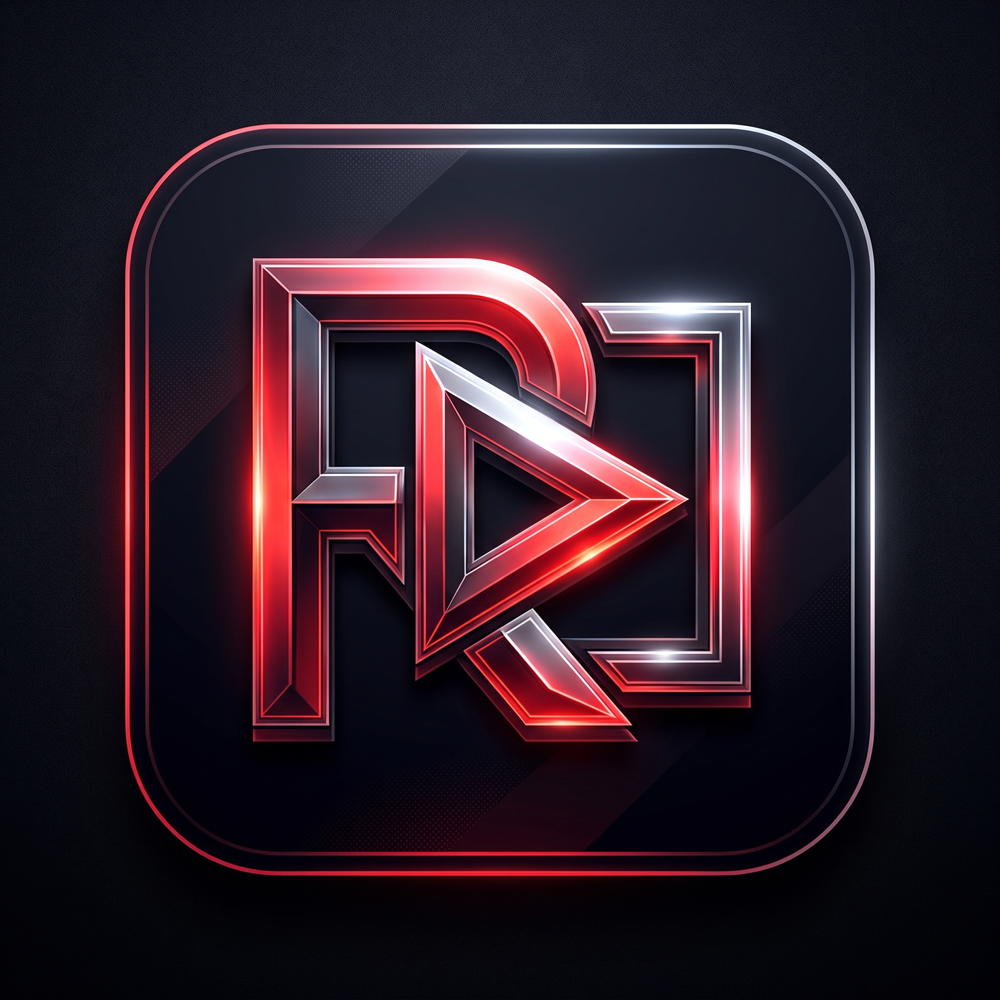

  

# RDX-YT

### Ad-Free Custom YouTube Client • Developed by Abdullah Naeem Rao

RDX-YT is an automated ReVanced build factory. GitHub Actions obtains a compatible stock YouTube APK, applies the official ReVanced patch bundle, brands the application as **RDX-YT**, signs it with an ephemeral build key, and publishes the result as a GitHub Release.

## Branding

- Application name: `RDX-YT`
- Package name: `com.rdx.yt`
- Custom launcher resources: `brand-res/`
- Developer: Abdullah Naeem Rao

## Build

Open **Actions → Build RDX-YT → Run workflow**. A successful run publishes `RDX-YT.apk` under release `v1.0.0`.

The workflow resolves the recommended YouTube version from the current official patch bundle and downloads it through the open-source [EFF apkeep](https://github.com/EFForg/apkeep) tool using its APKPure backend. Stock APKs, downloaded build tools, temporary signing keys, and intermediate artifacts are never committed.

## Installation note

The custom package is intended for a non-root installation. ReVanced GmsCore may be required for Google account sign-in and other Google Play Services functionality. Because the requested signing key is temporary, installing a later rebuild may require uninstalling the previous RDX-YT installation first.

## Disclaimer

This is an independent, unofficial project and is not affiliated with or endorsed by Google, YouTube, or the ReVanced project. YouTube is a trademark of Google LLC. Review the applicable terms and local laws before building or distributing patched applications.
